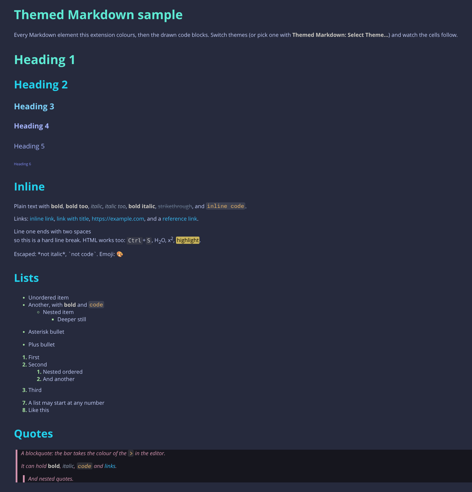
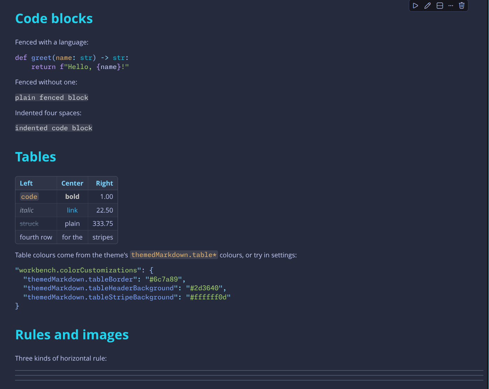
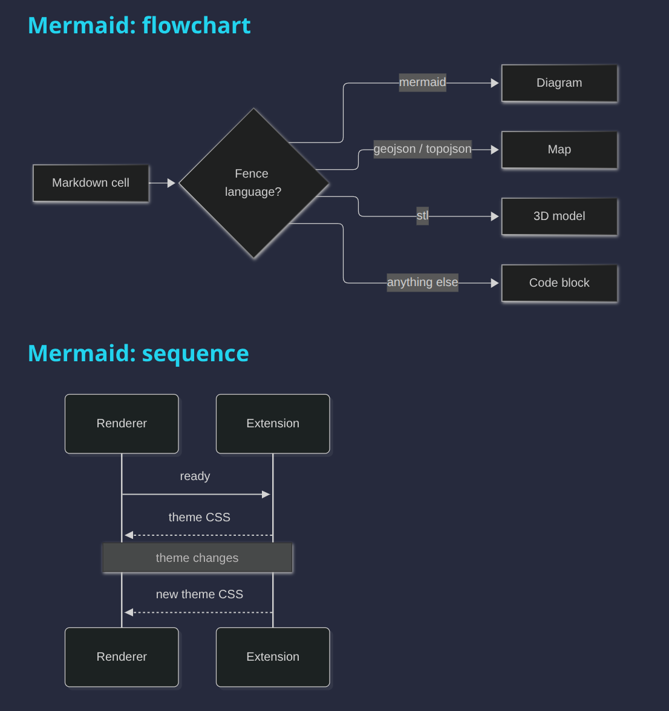
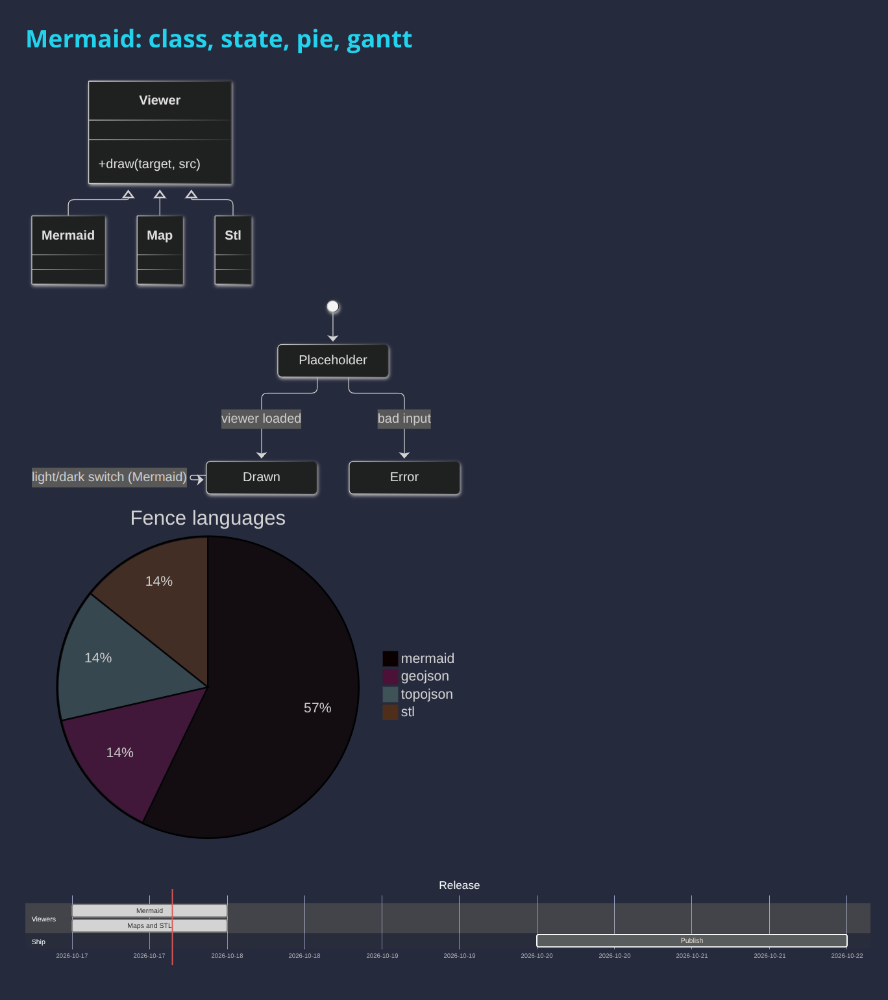

# themed-markdown-notebook-render

VS Code draws Markdown cells in notebooks (Jupyter `.ipynb` and others) with just two colours, your theme's foreground and background. Your theme has many more for Markdown, and you see them while you edit a cell. This extension keeps them after the cell renders: headings, bold, italic, strikethrough, inline code, code blocks, links, list bullets, quotes and their bar, table borders and rules.





The Markdown preview of `.md` files gets the same colours.

The colours are the same ones your theme uses for Markdown in the editor. If you've changed some of them yourself (with the `editor.tokenColorCustomizations` setting), your changes are used too. When you switch theme or change those colours, open notebooks and previews update straight away. If `window.autoDetectColorScheme` is on, the colours follow whichever of your preferred light or dark themes is active.

## Using another theme's colours

You can colour Markdown cells with a different theme from the one VS Code is using. Click the gear on the extension's page and choose **Select Theme…**, or run *Themed Markdown: Select Theme…* from the Command Palette. The list shows every installed theme, marked light or dark, plus *Follow active theme* to go back.

By default only the text colours change, so pick a theme whose colours read well on VS Code's background. To use a light theme inside a dark VS Code (or the other way round), turn on `themedMarkdownNotebookRender.paintBackground`. Each Markdown cell then gets the chosen theme's background, and Mermaid diagrams switch to its light or dark style. Code cells and the gaps between cells keep VS Code's own theme, because a renderer can only draw inside its cells.

## Settings

| Setting | Default | What it does |
|---|---|---|
| `themedMarkdownNotebookRender.theme` | empty | Theme to take colours from, by name as in `workbench.colorTheme` (e.g. `Monokai`). Empty follows the active theme. |
| `themedMarkdownNotebookRender.paintBackground` | `false` | Paint Markdown cells with the chosen theme's background and match Mermaid to its light or dark. Does nothing while `theme` is empty. |

## Table colours

Tables stay a plain grid until your theme, or your `workbench.colorCustomizations`, sets one of these colours. Each one turns on its own part:

| Colour | Effect |
|---|---|
| `themedMarkdown.tableBorder` | rounded outline and the line under the header |
| `themedMarkdown.tableInnerBorder` | grid lines inside the table (default: `tableBorder`) |
| `themedMarkdown.tableHeaderBackground` | header row background |
| `themedMarkdown.tableHeaderForeground` | header text |
| `themedMarkdown.tableStripeBackground` | every second row |
| `themedMarkdown.markBackground` | `<mark>` highlight background (default: the browser's yellow) |

For example, in `settings.json`:

```json
"workbench.colorCustomizations": {
  "themedMarkdown.tableBorder": "#5c6370",
  "themedMarkdown.tableStripeBackground": "#ffffff08"
}
```

## Diagrams, maps and 3D models

Like on GitHub, some fenced code blocks are drawn instead of shown as code:

| Fence | Shows |
|---|---|
| `mermaid` | [Mermaid](https://mermaid.js.org) diagram, in Mermaid's dark or light theme to match VS Code |
| `geojson`, `topojson` | map on OpenStreetMap tiles (needs internet); click a feature to see its properties |
| `stl` | 3D model (ASCII STL only); drag to rotate, scroll to zoom |





## Requirements

- VS Code 1.75 or newer, with the built-in Markdown Language Features extension enabled (it is by default).
- An extension that opens your notebooks, such as Jupyter for `.ipynb`.
- Nothing extra for diagrams: Mermaid, Leaflet and three.js ship inside the extension. Maps need internet for their OpenStreetMap tiles.

Building from source also needs Node.js with npm, and a POSIX `sh` to run `vendor.sh` (on Windows, use WSL or Git Bash).

## Install from source

```sh
npm install
npm run package                                                  # builds themed-markdown-notebook-render-0.1.12.vsix
code --install-extension themed-markdown-notebook-render-0.1.12.vsix
```

To try it without installing, run `npm install && sh vendor.sh` (which copies the viewers into `vendor/`), open this folder in VS Code and press F5. That starts an Extension Development Host with the extension loaded.

## Test

```sh
node test.js
```

## Limits

- Code blocks inside Markdown cells are one colour, because VS Code doesn't syntax-highlight them in notebooks.
- Binary STL files can't go in a code fence, so only ASCII STL is drawn.

### For theme authors

- Colours are read from the theme's `tokenColors`, following any theme it `include`s.
- Scope selectors that use `>` or `-` (exclusion) are not understood, and themes whose `tokenColors` point to a `.tmTheme` file are skipped. Both are rare; most themes use plain JSON.
- In `editor.tokenColorCustomizations`, the shorthands such as `comments`, `strings` and `keywords` are ignored. `textMateRules` are applied.

## How it works

It is built the same way as VS Code's built-in `markdown-math`. A notebook renderer extends `vscode.markdown-it-renderer` and adds a stylesheet to every Markdown cell; the extension reads the theme and sends that stylesheet to the renderer. For `.md` previews, the extension writes the same colours to `preview.css`, which it registers through `markdown.previewStyles`.
