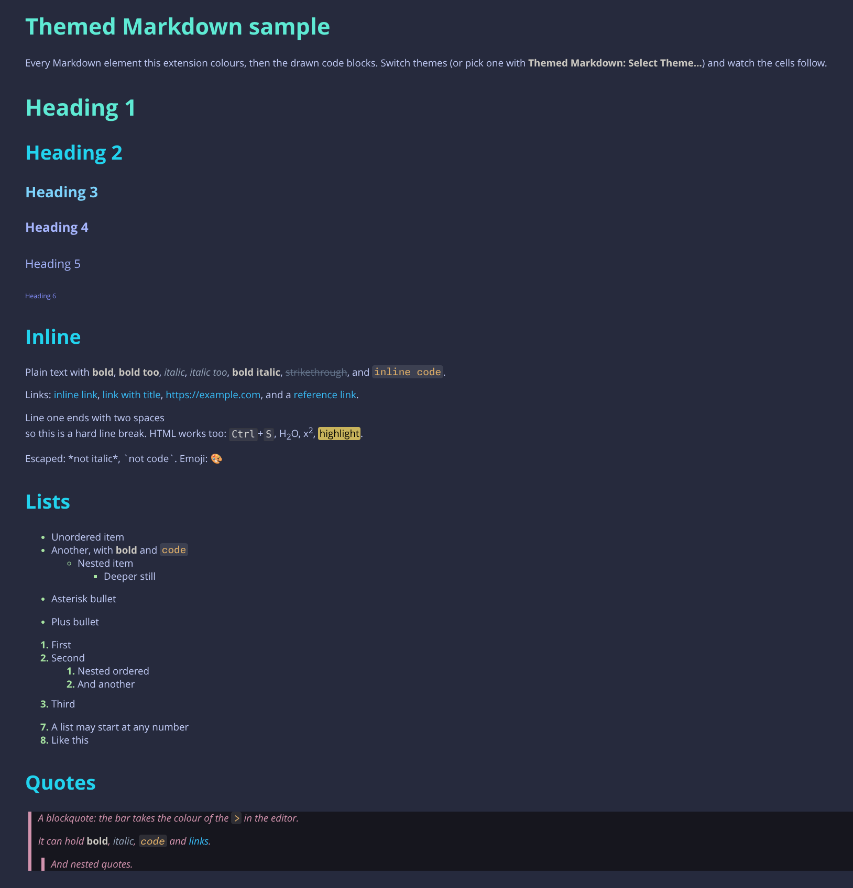
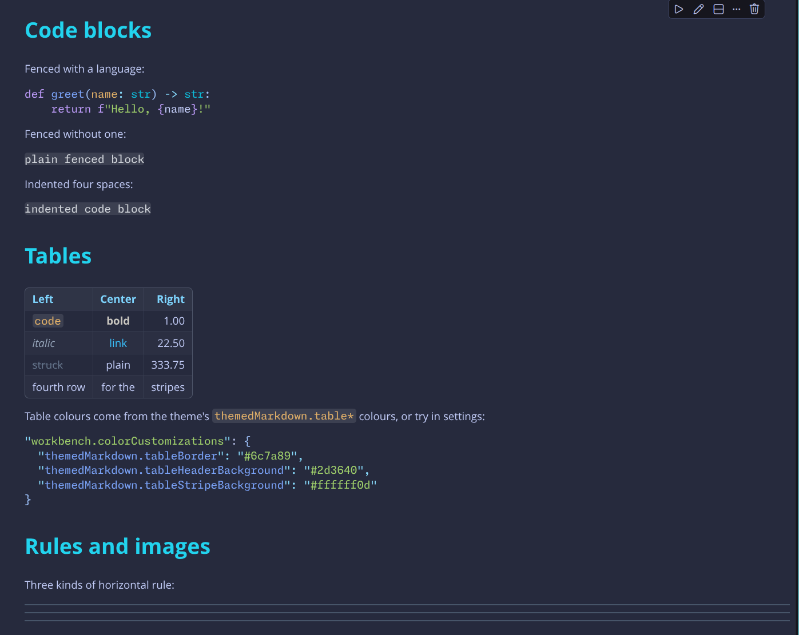
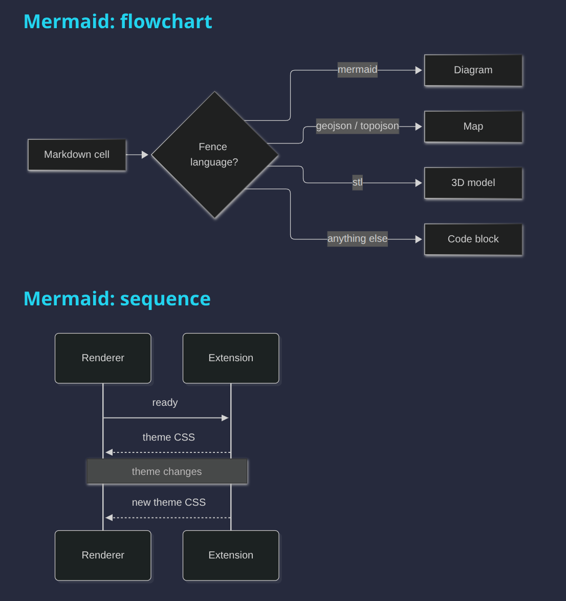
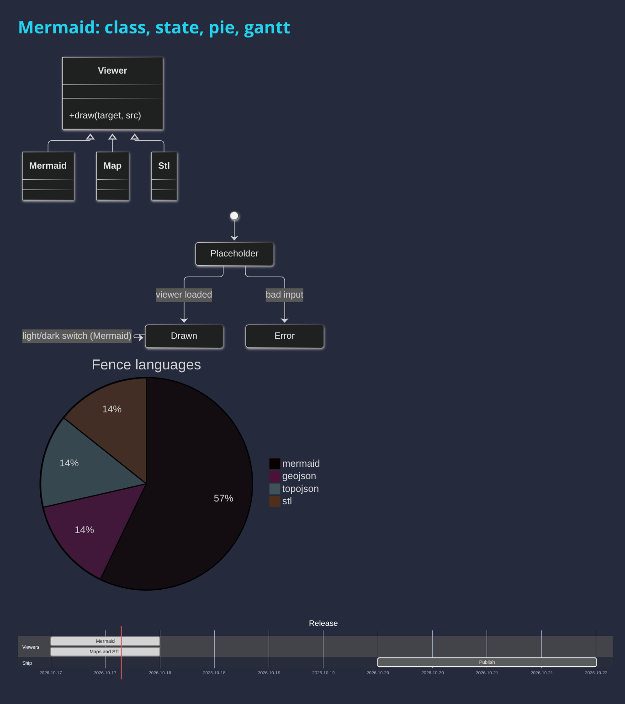

# themed-markdown-notebook-render

Markdown cells in VS Code notebooks (Jupyter `.ipynb` and others) render with only the theme's foreground and background colours. This extension renders them in the colours your theme gives Markdown **while editing**: headings, bold, italic, strikethrough, inline code, code blocks, links, list bullets, quotes and their bar, table borders and rules.





Colours come from the active theme's `tokenColors` (including themes it `include`s) plus your `editor.tokenColorCustomizations`. Switch theme and the open notebooks follow.

To use another theme's colours than the active one, click the gear on the extension's page and choose **Select Theme…** (also *Themed Markdown: Select Theme…* in the Command Palette), or set `themedMarkdownNotebookRender.theme` to its name. Empty follows the active theme. Only the text colours change, so pick a theme that suits VS Code's background, or turn on `themedMarkdownNotebookRender.paintBackground` to paint each Markdown cell with the chosen theme's background (so a light theme works in a dark VS Code) and have Mermaid diagrams follow its light or dark. Code cells and the space between cells keep VS Code's theme: a renderer can only draw inside its cells.

Tables are a plain grid unless the theme (or your `workbench.colorCustomizations`) sets any of these colours; each one switches on its part:

| Colour | Effect |
|---|---|
| `themedMarkdown.tableBorder` | rounded outline and the line under the header |
| `themedMarkdown.tableInnerBorder` | grid lines inside the table (default: `tableBorder`) |
| `themedMarkdown.tableHeaderBackground` | header row background |
| `themedMarkdown.tableHeaderForeground` | header text |
| `themedMarkdown.tableStripeBackground` | every second row |
| `themedMarkdown.markBackground` | `<mark>` highlight background (default: the browser's yellow) |

Code blocks are drawn, as on GitHub, when fenced as:

| Fence | Shows |
|---|---|
| `mermaid` | [Mermaid](https://mermaid.js.org) diagram, in Mermaid's dark or light theme to match VS Code |
| `geojson`, `topojson` | map on OpenStreetMap tiles (needs internet); click a feature for its properties |
| `stl` | 3D model (ASCII STL); drag to rotate, scroll to zoom |





It works like VS Code's built-in `markdown-math`: a notebook renderer extending `vscode.markdown-it-renderer` adds a style to every Markdown cell, and the extension sends it the theme CSS.

## Install

```sh
npm run package                                                  # builds themed-markdown-notebook-render-0.1.4.vsix
code --install-extension themed-markdown-notebook-render-0.1.4.vsix
```

Or run `npm install && sh vendor.sh` (copies the viewers into `vendor/`), open this folder in VS Code and press F5 to try it in an Extension Development Host.

## Test

```sh
node test.js
```

## Limits

- Selectors with `>` or `-` (exclusion) are not understood. Themes whose `tokenColors` point to a `.tmTheme` file are ignored. These are rare; most use JSON.
- The `comments`, `strings`, `keywords`… shorthands in `editor.tokenColorCustomizations` are ignored, but `textMateRules` are applied.
- Code blocks inside Markdown cells take one colour, because VS Code doesn't syntax-highlight them in notebooks.
